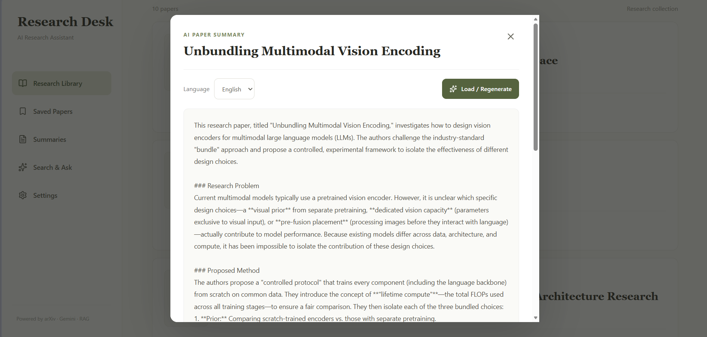
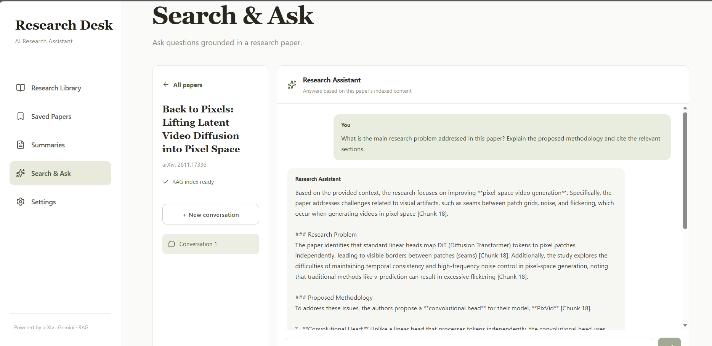
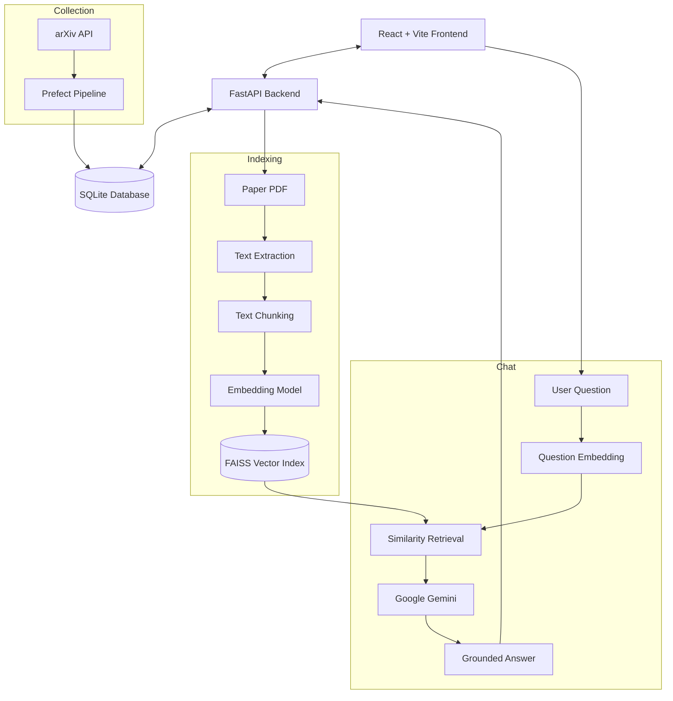

# AI Research Assistant

An AI research assistant that collects recent AI papers from arXiv, summarizes them using Google Gemini, and enables users to ask questions about research papers through Retrieval-Augmented Generation (RAG).


## Key Features

- **Paper Discovery:** Collect AI research papers from arXiv using a Prefect pipeline.
- **AI Summarization:** Generate research paper summaries using Google Gemini.
- **RAG-Powered Chat:** Ask questions about papers using relevant passages retrieved from their PDFs through FAISS.
- **Conversation History:** Store conversations associated with research papers.
- **Personal Library:** Save and manage papers of interest.
- **Background Updates:** Trigger paper collection from the interface and monitor its progress.

## Application Screenshots

### Paper Discovery


### AI-Powered Summarization


### RAG-Powered Chat


## System Architecture

The application combines automated research collection, document indexing, and LLM-powered question answering.



### Architecture Components

- **Data Collection:** Prefect orchestrates paper collection from arXiv.
- **Data Storage:** SQLAlchemy and SQLite manage paper metadata, summaries, saved papers, and conversation history.
- **Document Retrieval:** A multilingual sentence-transformer model generates embeddings, while FAISS enables vector similarity search.
- **Application Layer:** FastAPI provides backend endpoints, and React with Vite provides the user interface.

## Technology Stack

| Component | Technologies |
|---|---|
| Languages | Python, TypeScript |
| Backend | FastAPI, SQLAlchemy, Alembic |
| Database | SQLite |
| LLM | Google Gemini |
| Embedding Model | paraphrase-multilingual-MiniLM-L12-v2 |
| Vector Search | FAISS |
| Workflow Orchestration | Prefect |
| Frontend | React, Vite |
| Testing | pytest, Playwright |

## How RAG Works

1. Download the selected research paper's PDF.
2. Extract the document text and split it into chunks.
3. Generate vector embeddings for each chunk.
4. Store the embeddings in a FAISS index.
5. Convert the user's question into an embedding.
6. Retrieve the most relevant document chunks using similarity search.
7. Send the retrieved context to Google Gemini to generate a grounded answer.

## Getting Started

### Prerequisites

- Python 3.10+
- Node.js (LTS) and npm
- [Google Gemini API Key](https://aistudio.google.com/apikey)

### 1. Backend Setup

Clone the repository:

```powershell
git clone https://github.com/IiRemaz/ai-research-assistant.git
cd ai-research-assistant
```

Create and activate a virtual environment:

```powershell
python -m venv .venv
.\.venv\Scripts\Activate.ps1
```

Install dependencies:

```powershell
pip install -e ".[dev]"
```

Copy `.env.example` to `.env` and configure your Gemini API key:

```env
GEMINI_API_KEY=your_api_key
```

Initialize the database:

```powershell
python -m ai_research_assistant.init_db
```

Start the FastAPI server:

```powershell
python -m uvicorn ai_research_assistant.api.main:app --reload
```

API documentation:

http://127.0.0.1:8000/docs

### 2. Frontend Setup

Open a second terminal:

```powershell
cd frontend
npm install
npm run dev
```

Open the application:

http://localhost:5173

To configure a different backend URL, create `frontend/.env.local`:

```env
VITE_API_BASE_URL=http://127.0.0.1:8000
```

## Usage Notes

- **Paper Indexing:** Chat requires a FAISS index for each paper. If an index is missing, select **Index this paper**. Initial indexing may take longer because the PDF and embedding model need to be downloaded.
- **Paper Updates:** Select **Update Papers** to collect recent research papers and monitor the update status.
- **Summarization:** Generate summaries using Google Gemini.

## Testing

The project includes backend tests and frontend end-to-end tests.

### Backend Tests

Run the backend test suite:

```powershell
python -m pytest -q tests
```

Generate a coverage report:

```powershell
python -m pytest --cov=ai_research_assistant --cov-report=term-missing tests
```

### Frontend End-to-End Tests

```powershell
cd frontend
npm install
npx playwright install chromium
npm run test:e2e
```

Playwright tests use mocked HTTP responses to validate frontend behavior without making live requests to Gemini or arXiv.

## Engineering Considerations & Limitations

The application is designed for local execution rather than public production deployment.

- **Authentication:** User authentication and access control are not implemented.
- **Background Processing:** Paper updates run through a FastAPI background task. A production deployment would benefit from dedicated workers and a task queue.
- **Long Documents:** Summarizing lengthy papers may exceed the LLM context window.
- **API Rate Limiting:** Usage quotas and rate limiting are not implemented for expensive operations.
- **Production Scalability:** Public deployment requires additional infrastructure for persistent storage, security, and monitoring.

## Project Status

**Functional Local Prototype** — Supports research paper discovery, AI summarization, RAG-powered chat, and a personal research library.
